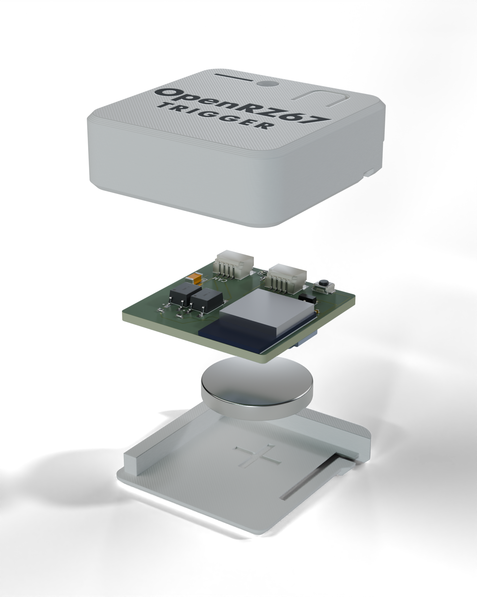
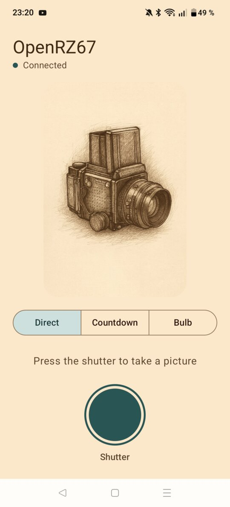
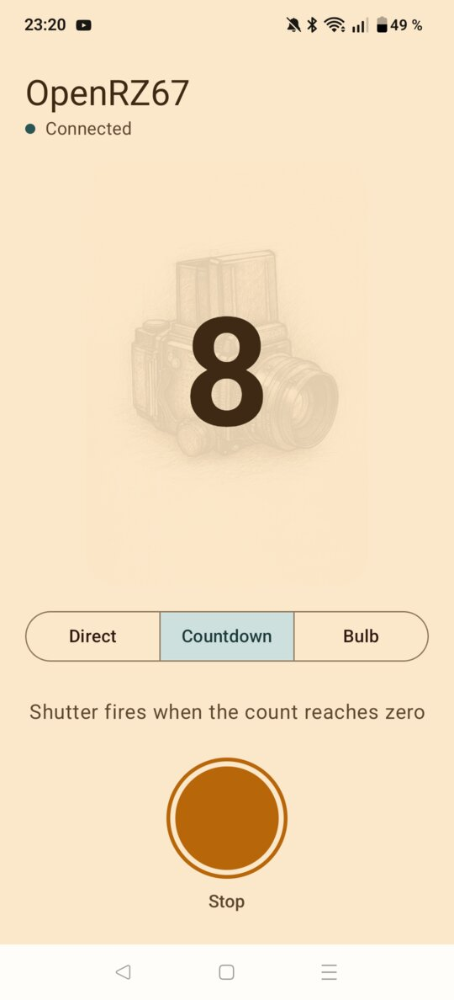
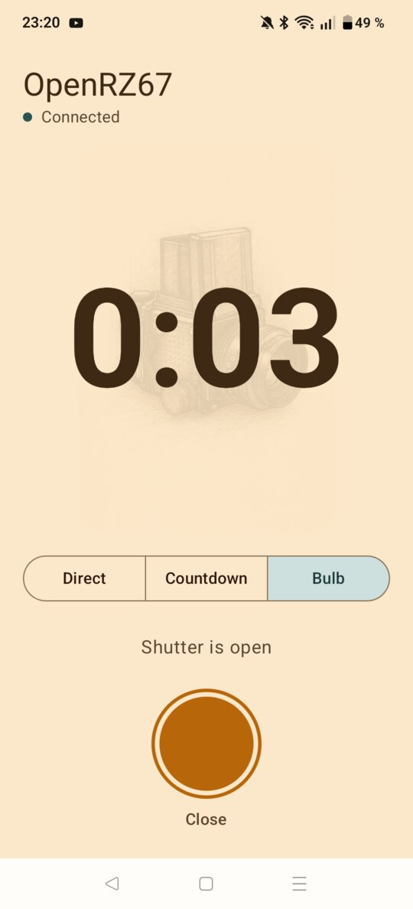
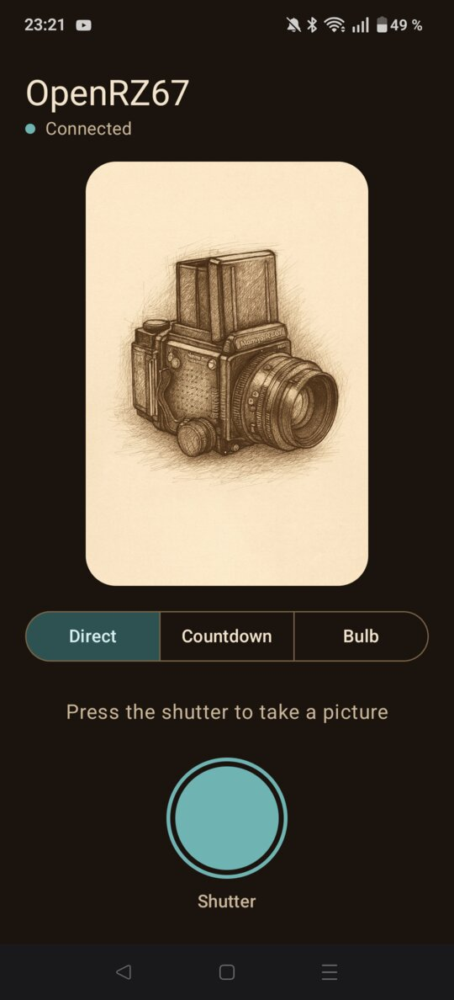

# openrz67-trigger

A Bluetooth remote release for the Mamiya RZ67. A small box on a coin cell plugs into the
camera's remote port. An Android or iPhone app fires the shutter, holds it open for bulb, or
runs a countdown.



<p>
  
  
  
  
</p>

## What it does

- Instant release, bulb, and a countdown of 1 to 255 seconds.
- Runs on a CR2032. It sleeps between uses and wakes on a button press.
- Nothing to solder. The board comes assembled from JLCPCB, everything else plugs in.
- Firmware updates over Bluetooth.

## Build one

**→ [Build guide](docs/build-guide.md)**: parts, ordering the board, printing the case,
flashing, the camera cable.

In short:

1. Order the assembled board from JLCPCB with the files in [`kicad/out/`](kicad/out/).
2. Print the case from [`case/`](case/).
3. Flash the firmware once with a Raspberry Pi Pico. After that, updates go over Bluetooth.
4. Make the camera cable from a Qwiic pigtail.
5. Install the app.

## Apps

- **Android:** [openrz67-android](https://github.com/mhellevang/openrz67-android), APK on the
  [releases page](https://github.com/mhellevang/openrz67-android/releases/latest).
- **iPhone:** [openrz67-ios](https://github.com/mhellevang/openrz67-ios), built from source in
  Xcode for now.

## Using it

| You do | It does |
|---|---|
| Press the button | Wakes and waits 5 minutes for a phone. The LED blinks every 2 s |
| Open the app | Connects on its own. The LED goes dark |
| Leave it | Stays on while the app is connected. With no phone for 5 minutes, it sleeps |
| Hold the button 3 s | Off, until the next press |

For bulb, set the camera's shutter-speed dial to `B`. The camera closes the shutter by itself
after about 60 seconds.

## What's in here

```
openrz67-trigger/
├── kicad/        # the board, generated from tools/design.py; fab files in out/
├── case/         # 3D-printed case (build123d), shell + sliding floor + light pipe
├── firmware/     # Zephyr application for the nRF54L15
└── docs/
    ├── build-guide.md
    ├── protocol.md     # camera port and Bluetooth commands
    ├── perfboard.md    # the same circuit on perfboard, off-the-shelf parts
    ├── support.md      # app help
    ├── privacy.md      # app privacy policy
    ├── render/         # renders docs/img/case-pcb.png with Blender
    └── notes/          # design history and reasoning
```

Earlier ESP32-C3 versions are at tag
[`esp32-final`](https://github.com/mhellevang/openrz67-trigger/tree/esp32-final/esp32).

## License

[MIT](LICENSE), covering the firmware, the KiCad design files and the enclosure sources. MIT
is written for software, but its grant is broad enough to serve a hardware design;
the closest hardware-specific equivalent is CERN-OHL-P.

The footprints, symbols and 3D models in `kicad/openrz67-nrf.pretty/`,
`openrz67-nrf.kicad_sym` and `openrz67-nrf.3dshapes/` are **not** covered, because they are
not mine to license. They come from the EasyEDA/LCSC part libraries and are redistributed
here for convenience under their originators' terms.

Not affiliated with Mamiya.

## Credits

The camera connector pinout that made this project possible was described to me by
Julio Ryuuzaki, who built and sold the Bluetooth [RZ Blue](https://ryuuzaki.jp/) trigger
for years. He answered a cold email in December 2022 with the essentials: four pins, one
ground, two live, one unconnected. He also warned that the camera closes the shutter by
itself after about a minute in bulb mode. Thank you.
