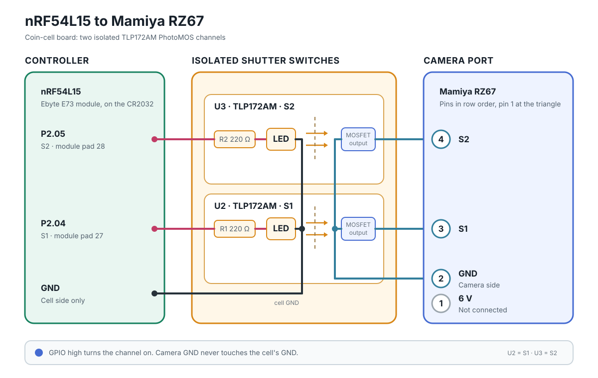

# Camera port and Bluetooth protocol

For app developers and anyone building their own hardware. The apps work with anything that
speaks this protocol.

## Camera connection

Viewed from the front, the camera's four-pin remote-control port is:

1. 6 V, wired through, unused by the board
2. GND
3. S1 switch
4. S2 switch

To trigger the shutter, the PhotoMOS outputs short S1/S2 to camera GND. For bulb exposures,
set the shutter-speed dial to `B`. The camera closes the shutter by itself after about
60 seconds even if the switches stay closed.

## BLE protocol

The device advertises as `OpenRZ67` with service UUID `c9239c9e-6fc9-4168-b3aa-53105eb990b0`
and characteristic `458d4dc9-349f-401d-b092-a2b1c55f5319`. Send commands using Write Without
Response. The characteristic is open (no pairing): anyone in radio range can fire the camera,
which is accepted for a shutter release.

Also exposed: the standard Device Information Service (`0x180A`, firmware revision `0x2A26`),
and:

* characteristic `cda71ce6-4af9-4aa2-8d34-329c2acdae09` (read + notify): battery voltage in
  millivolts, little-endian `uint16`.
* Battery Service (`0x180F`, Battery Level `0x2A19`): the same reading as a percentage, which
  is what phones show without any app, linear from 2.5 V (0 %) to 3.0 V (100 %).

**Single-byte commands** (value = button × 10 + state):

| Value | Action |
|-------|--------|
| 11 | Trigger shutter with a 100 ms pulse |
| 10 | Clear status LED; no shutter action |
| 21 | Start bulb mode: holds S1/S2 closed until 20 is sent. Camera dial must be on `B` |
| 20 | End bulb mode |
| 31 | Start countdown with the default duration of 10 s |
| 30 | Cancel countdown |

**Three-byte commands** `[command, duration, action]`:

| Bytes | Action |
|-------|--------|
| `[3, n, 1]` | Start countdown of *n* seconds (`1–255`) |
| `[3, _, 0]` | Cancel countdown |

Starting a trigger or bulb exposure cancels any pending countdown. Commands are queued in
the BLE callback and executed outside it, so the BLE stack never blocks on shutter timing.
