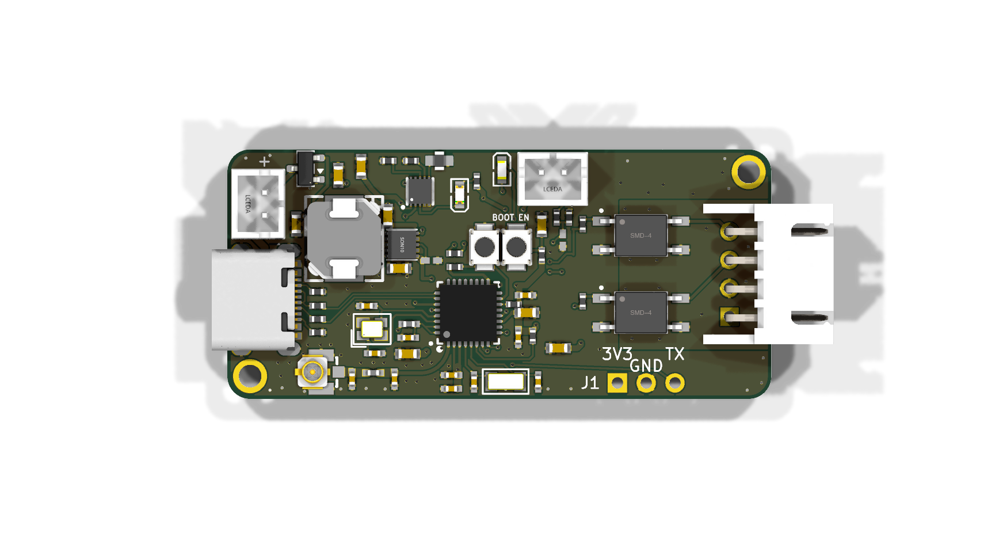
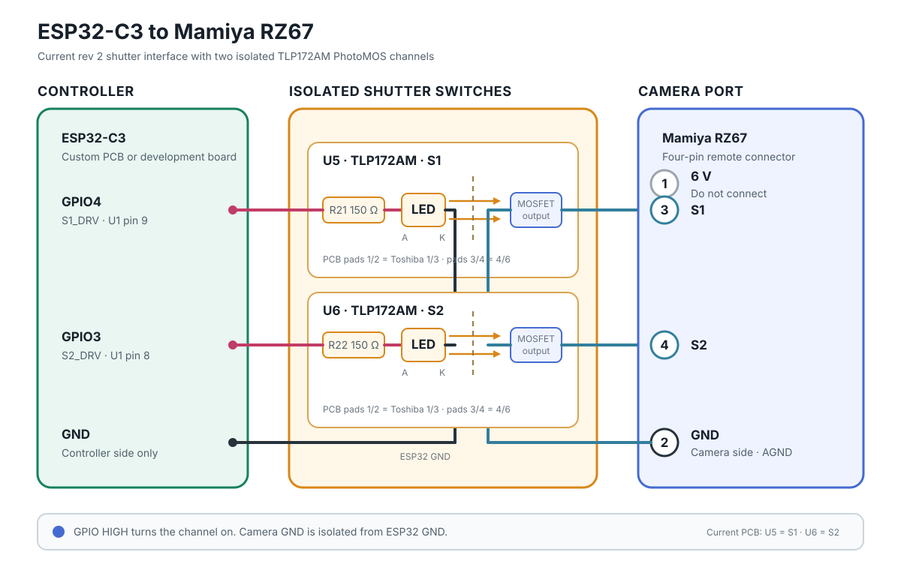

# ESP32-C3 trigger

An ESP32-C3 on a custom PCB with a LiPo, charger and power switch, in a
3D-printed case. Rev 2 is in regular use. The camera port and the BLE protocol are described
in the [top-level README](../README.md).

## Features

* Instant shutter release
* Bulb mode for remote long exposures
* Self-timer countdown with app-configurable duration
* Runs off a small LiPo, with light sleep between BLE events (see [Power](#power))

## Hardware

A custom PCB in a 3D-printed case:



| Directory | What |
|---|---|
| [`pcb/kicad/`](pcb/kicad/) | KiCad source, generated fab files in `out/`, design history in `notes/` |
| [`pcb/archive/`](pcb/archive/) | exactly what was sent to the fab, one folder per order |
| [`case/`](case/) | parametric build123d enclosure |
| [`BOM.md`](BOM.md) | every part that is not soldered to the PCB (cell, switch, antenna, cables) |

The boards in use are **rev 2**, verified working. The source is **rev 3**, not yet fabricated;
the case fits both.

On the board:

* ESP32-C3FH4 with an FPC antenna on a U.FL connector
* 2× Toshiba TLP172AM PhotoMOS relays (solid-state, isolated) close the shutter contacts
* TI BQ25185 charger (111 mA) and TPS63031 buck-boost, 250 mAh LiPo on `BAT1`, reverse-battery
  P-FET (rev 3)
* KCD11 rocker power switch on `S3`
* `J1`, unpopulated header for bench logging: 3V3, GND, GPIO21/TX (plus GPIO6 on rev 2)

The firmware also runs on any ESP32-C3 board with two isolated switch channels: assign two
output-capable GPIOs in `src/main.cpp`. On the PCB each GPIO drives a PhotoMOS LED through
150 Ω; the isolated output closes S1 or S2 to camera ground while the GPIO is HIGH. Keep
ESP32 ground and camera ground separate.



### Pinout

| GPIO | Rev 2 (built) | Rev 3 (source) |
|------|---------------|----------------|
| 3    | Shutter output S2 (`S2_DRV`) | Battery sense (`VBAT_SENSE`): `SW_SYS` through a 1 MΩ / 1 MΩ divider |
| 4    | Shutter output S1 (`S1_DRV`) | same |
| 6    | `J1` pin 4, spare | Shutter output S2 (`S2_DRV`) |
| 20   | Status LED (`D4`, blue) | same |

The firmware covers every revision through build flags in `platformio.ini`: `S1_PIN` (rev 1),
`S2_PIN` and `VBAT_ADC_PIN` (rev 3).

### LEDs

Both LEDs sit under the same light pipe in the lid.

| LED | Meaning |
|-----|---------|
| Red `D3`, steady | Charging. Driven by the charger IC, so it works with the power switch off. Off = full, no USB, or fault |
| Blue `D4`, slow soft pulse | On, waiting for a phone |
| Blue `D4`, dim steady | Phone connected |
| Blue `D4`, full steady | Trigger pulse (2 s) or bulb exposure |
| Blue `D4`, fast blink | Countdown running |

### Camera connector

`U4` is a JST S4B-XH-A four-pin side-entry header, opening out of the right board edge:

| U4 pin | Camera signal |
|--------|---------------|
| 1      | Camera 6 V, unused by the board |
| 2      | GND |
| 3      | S1 |
| 4      | S2 |

Verify the pin 1 orientation before assembling the camera cable.

## Battery reading (rev 3)

The battery characteristic carries the `SW_SYS` voltage, refreshed every 10 s. On battery
this is the cell voltage (about 4200 full, 3500 low); on USB it is the charger's SYS voltage,
which is higher. It is not a reliable USB-present flag: treat roughly 4250–4350 as undecided.
The Battery Service percentage is linear from 3500 mV (0 %) to 4200 mV (100 %).

## Building

[PlatformIO](https://platformio.org/) with the [pioarduino](https://github.com/pioarduino/platform-espressif32)
platform (Arduino core 3.3, ESP-IDF 5.5, NimBLE):

```bash
pio run
pio run -t upload
```

If uploading does not start, hold `BOOT`, press and release `EN`, then release `BOOT` and retry.

| Env | Board |
|---|---|
| default | rev 2 |
| `rev1` | rev 1 (S1 on GPIO 21) |
| `rev3`, `rev3-debug` | rev 3 (S2 on GPIO 6, battery sense on GPIO 3) |
| `debug` | rev 2 with USB CDC logging and `VERBOSE=1` |

The production build has no serial output. UART0 is not used for logging because its RX pin
(GPIO 20) drives the status LED; GPIO 21 (UART0 TX) is on `J1` for a TX-only dongle.

`pio check` runs cppcheck over `src/`; CI (`.github/workflows/firmware.yml`) builds every env
and runs it on each push.

## Power

The chip runs at 80 MHz with DFS down to 10 MHz, 0 dBm BLE TX power, and automatic light
sleep between BLE events: the radio wakes it for each one, so the phone connection stays up
and a trigger arrives as before. `custom_sdkconfig` in `platformio.ini` has pioarduino
rebuild the Arduino core with `CONFIG_PM_ENABLE`, tickless idle, BLE modem sleep and the
32.768 kHz crystal `X2` as the BLE low-power clock (the first build per machine takes a few
minutes). Consequences:

* The status LED runs on LEDC from `RC_FAST` in keep-alive mode, since the APB clock stops
  in light sleep.
* Light sleep releases every GPIO, so a PM lock keeps the chip awake while the shutter is
  open (bulb and the trigger pulse).
* The USB Serial/JTAG port drops off the bus in light sleep, so the `debug` env stays awake,
  and flashing a sleeping production build may need the `BOOT`/`EN` sequence above.

If `X2` does not start, ESP-IDF falls back to the internal RC and BLE keeps working without
light sleep. Current draw is not measured yet.

