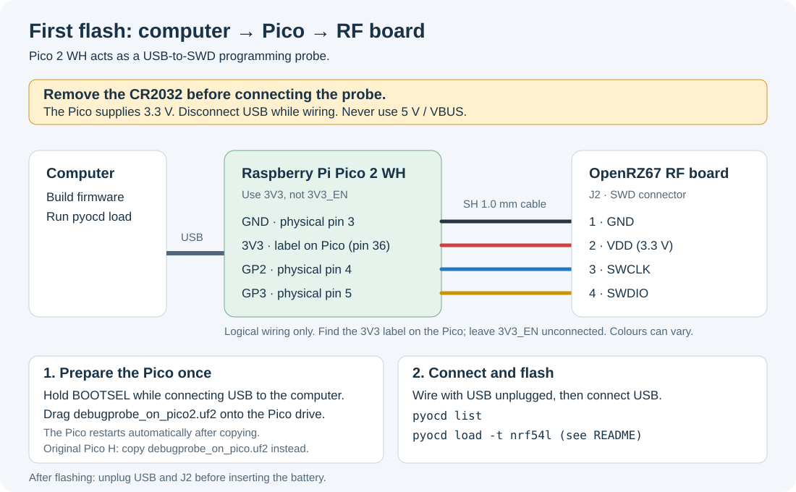

# Firmware (Zephyr / nRF Connect SDK)

Zephyr application for the coin-cell trigger in [`../kicad/`](../kicad/), controlled from the
[Android](https://github.com/mhellevang/openrz67-android) and
[iOS](https://github.com/mhellevang/openrz67-ios) apps over Bluetooth. Builds with nRF Connect
SDK v3.4.1 (MCUboot 39 kB, app 147 kB flash, 45 kB RAM); runs on the Rev A board.

| File | What |
|---|---|
| `src/main.c` | the application: GATT, advertising, shutter, countdown, LED, battery, sleep |
| `prj.conf` | Kconfig: Bluetooth peripheral, BAS, DIS, SMP (updates), ADC, GPIO, HFINT calibration, no serial |
| `sysbuild.conf`, `sysbuild/mcuboot.conf` | MCUboot as the bootloader, fed watchdog during a swap |
| `debug.conf` | add-on: logging over Segger RTT |
| `dfu.py` | update over Bluetooth from a computer |
| `boards/openrz67/openrz67_nrf/` | the board: pin map (devicetree), SoC, flash runners |
| `boards/adafruit_feather_nrf52840_nrf52840_uf2.*` | the perfboard variant on an Adafruit Feather nRF52840 Express, see [`../docs/perfboard.md`](../docs/perfboard.md) |

## Behaviour

- Power on (or a button press from sleep): advertises as `OpenRZ67` for 3 minutes. No
  connection in that time: System OFF (about 0.7 µA), the button wakes it. A running
  countdown finishes first.
- Connected: stays on as long as the app holds the link. After a disconnect it advertises
  3 minutes again (started from the `recycled` connection callback), then sleeps.
- Button held 3 s: off. It disconnects the app, waits for the button to be released (a held
  button would wake it again at once) and goes to System OFF. A press wakes it.
- Commands on the command characteristic, write without response:
  - 1 byte `button * 10 + state`: button 1 trigger, 2 bulb, 3 countdown; state 1 start, 0 stop.
  - 3 bytes `[3, seconds, state]`: countdown with its duration.
- Trigger: S1 on, 10 ms, S2 on, 100 ms, both off. Bulb: S1 then S2 on until stop or a
  disconnect. Countdown: fast LED blink, then a trigger.
- Watchdog: 5 s. A hung main loop resets the chip, which releases S1/S2.
- LED: solid for 2 s after a trigger, a short blink every second while a bulb exposure is
  held, fast blink in a countdown, a short blink every 2 s while advertising, off when connected and idle.
- Battery: VDD measured on the internal ADC channel every 60 s; mV on the custom
  characteristic (uint16 LE, notify), percent on the Battery Service, linear 2.5 to 3.0 V. A board that measures through a divider
  (the Feather) gives the ratio and range in `zephyr,user`, and an enable pin if the divider
  is switched; then it is on only for the reading.

## Pins

| Function | nRF54L15 | Module pad |
|---|---|---|
| S1 PhotoMOS LED, high drive | P2.04 | 27 |
| S2 PhotoMOS LED, high drive | P2.05 | 28 |
| Status LED | P2.00 | 18 |
| Button, to GND (SENSE, latch detect, no GPIOTE channel) | P1.04 | 7 |
| SWCLK / SWDIO | | 11 / 12, `J2` pins 3 / 4 |

Both crystals (32 MHz, 32.768 kHz) are inside the module. Ebyte does not give their load
capacitance; the devicetree uses the nRF54L15 DK values. At boot the firmware asks the chip
whether the module has the DC/DC inductor and turns DC/DC on if so (about half the radio
current); otherwise it stays on the LDO.

Chip anomalies handled: 114 (a bouncing button on a SENSE pin can leave ~300 µA on in idle;
`latch-detect` on the port), 30 (HFINT drifts in the cold and GRTC wake-ups fail;
`CONFIG_CLOCK_CONTROL_NRF_HFINT_CALIBRATION`).

## Build and flash

Needs the nRF Connect SDK v3.4.1 and its toolchain, on Windows, macOS or Linux. Install both
with Nordic's guide,
[Installing the nRF Connect SDK](https://nrfconnectdocs.nordicsemi.com/ncs/latest/nrf/installation/install_ncs.html),
and pick v3.4.1. Run the commands below in a terminal that has the SDK's environment, set up
as the guide shows, from the SDK's workspace directory. They are written for a POSIX shell;
in PowerShell or cmd, write the paths straight into the commands.

### Signing key

MCUboot only boots images signed with the key it was built with. Make the key once, keep it
outside the repository and keep a backup: without it, updates need the probe again.

```sh
python bootloader/mcuboot/scripts/imgtool.py keygen -t ed25519 -k /path/to/mcuboot-ed25519.pem
```

Without `SB_CONFIG_BOOT_SIGNATURE_KEY_FILE` the build uses MCUboot's public test key (with a
warning), and anyone could sign an image the board accepts.

### Build

The board lives in this directory, so pass it as `BOARD_ROOT`. Sysbuild builds MCUboot and the
app and signs the app. `FW` is this directory, `KEY` the signing key:

```sh
FW=/path/to/openrz67-trigger/firmware
KEY=/path/to/mcuboot-ed25519.pem
west build -b openrz67_nrf/nrf54l15/cpuapp -s $FW -d $FW/build -- -DBOARD_ROOT=$FW -DSB_CONFIG_BOOT_SIGNATURE_KEY_FILE=\"$KEY\"
```

Two other builds, when you need them:

```sh
west build -b openrz67_nrf/nrf54l15/cpuapp -s $FW -d $FW/build -- -DBOARD_ROOT=$FW -DSB_CONFIG_BOOT_SIGNATURE_KEY_FILE=\"$KEY\" -DEXTRA_CONF_FILE=debug.conf   # RTT logging
west build --no-sysbuild -p -b adafruit_feather_nrf52840/nrf52840/uf2 -s $FW -d $FW/build -- -DBOARD_ROOT=$FW   # perfboard variant, no MCUboot; copy build/zephyr/zephyr.uf2 to the Feather
```

Outputs: `build/mcuboot/zephyr/zephyr.hex` and `build/firmware/zephyr/zephyr.signed.hex`
(MCUboot and the signed app, for the probe) and `build/dfu_application.zip` (app only, for an
update over Bluetooth).

For CLion or clangd, link the build's compilation database to the repo root (ignored by git):

```sh
ln -s firmware/build/firmware/compile_commands.json compile_commands.json
```

### Update over Bluetooth

Once MCUboot is on the board, the app updates from a phone. Close the OpenRZ67 app first, the
board takes one connection.

1. Copy `build/dfu_application.zip` to the phone.
2. Wake the board (button) so it advertises.
3. In nRF Connect Device Manager (Nordic, iOS and Android): pick `OpenRZ67`, Image, Firmware
   Upgrade, select the zip, mode "Test and Confirm", Start.

The board restarts into the new image. If that image does not come back on Bluetooth, MCUboot
falls back to the old one on the next reset.

From a computer instead (needs [uv](https://docs.astral.sh/uv/)), with the board awake and the
phone app closed:

```sh
uv run $FW/dfu.py   # default: $FW/build/firmware/zephyr/zephyr.signed.bin
```

It uploads, marks the image for a test boot, resets, checks that the new image runs and then
confirms it.

### First flash with the probe



Flashing is over SWD through `J2`, a JST SH 1.0 mm connector: a Qwiic / STEMMA QT cable with
female Dupont ends goes straight onto a Raspberry Pi Pico 2 WH (pre-soldered headers) running
Raspberry Pi's `debugprobe_on_pico2.uf2` (CMSIS-DAP; `debugprobe_on_pico.uf2` on a Pico H),
no soldering anywhere.

1. Download **`debugprobe_on_pico2.uf2`** for the Pico 2 WH from the
   [debugprobe releases](https://github.com/raspberrypi/debugprobe/releases).
   For an original Pico H, download `debugprobe_on_pico.uf2` instead.
2. Hold **BOOTSEL** on the Pico while plugging its USB cable into the computer, then release it.
   Open the Pico drive that appears and drag the downloaded
   **`debugprobe_on_pico2.uf2`** file onto it, just as you would copy a file to a USB stick.
   For an original Pico H, copy `debugprobe_on_pico.uf2` instead. The Pico automatically
   restarts as a CMSIS-DAP probe when the copy finishes. This is a one-time step.
   The drive name tells which file you need: `RP2350` is a Pico 2 (`debugprobe_on_pico2.uf2`),
   `RPI-RP2` is a Pico H (`debugprobe_on_pico.uf2`). If the drive is still there after the
   copy, the file was the wrong one.
3. Unplug USB, remove the RF board's **CR2032**, and connect the four wires below to **J2**.
   The Pico supplies 3.3 V during flashing. Use the side header pins on the Pico; the drawing
   shows logical connections, not physical pin positions. The power pin is labelled **3V3**
   on the Pico: use that label to find it. **3V3_EN** is a different pin and must stay unconnected.
   Physical pin numbers below are an extra reference. Cable colours vary between cables, so
   go by position: with the **SWD** label upright, pin 1 is on the left, next to the white dot.
4. Connect the Pico to the computer over USB. After building the firmware, in the same
   terminal:

```sh
python -m pip install --upgrade pyocd
pyocd list
pyocd load -t nrf54l --frequency 4000000 $FW/build/mcuboot/zephyr/zephyr.hex $FW/build/firmware/zephyr/zephyr.signed.hex
pyocd reset -t nrf54l
```

`pyocd list` should show the Pico. `$FW` is the firmware directory set in the build steps.
On Linux, pyOCD needs [udev rules](https://github.com/pyocd/pyOCD/tree/main/udev) to reach
the probe.
`west flash --runner pyocd` does not work with this sysbuild setup; it stops with
`KeyError: 'CONFIG_FLASH_LOAD_OFFSET'`. The warning `NRF54L15 is not in a secure state` is
normal: the chip is not locked, so it can be flashed again.

| `J2` pin | Position (SWD label upright) | Pico pin |
|---|---|---|
| 1 GND | left, white dot | GND (pin 3) |
| 2 VDD | second | **3V3**, as labelled on the Pico (pin 36). Leave **3V3_EN** unconnected. With the cell **out**, the probe powers the board, so both sides run at 3.3 V. Never with the cell in, it would charge the CR2032 |
| 3 SWCLK | third | GP2 (pin 4) |
| 4 SWDIO | right | GP3 (pin 5) |

There is no reset line; the probe resets the chip over SWD.
After flashing, unplug USB and disconnect J2 before inserting the battery. Subsequent app
updates can use Bluetooth as described above.

A J-Link can be used instead of the Pico with `west flash -d $FW/build --runner jlink`;
the Pico wiring table above does not apply to it.
