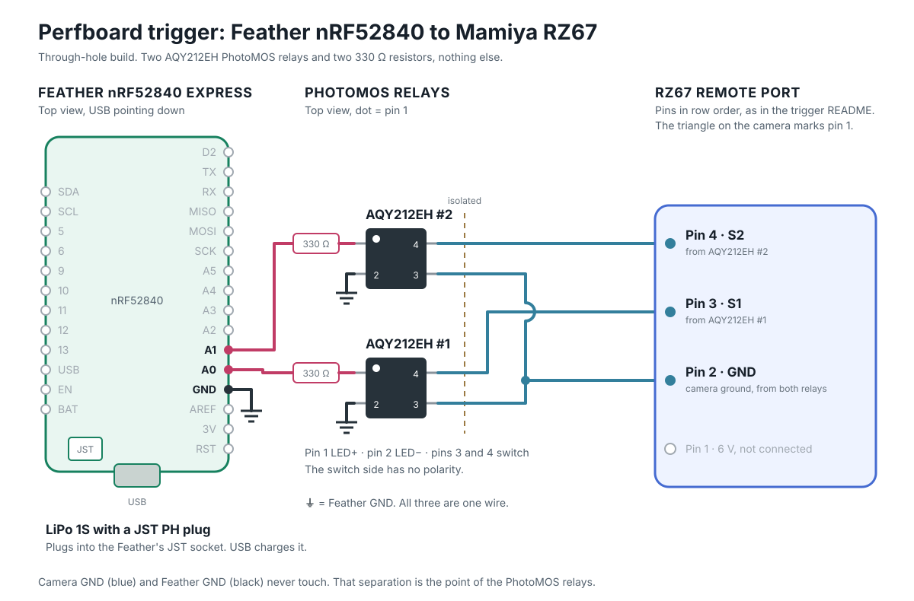

# Perfboard variant: sketch

Not built or tested. A do-it-yourself path for people who do not want to order assembled
boards from JLCPCB: off-the-shelf parts, through-hole soldering only, same Zephyr firmware and
GATT as the coin-cell board, so the apps do not change.

## Parts

| What | Note |
|---|---|
| Adafruit Feather nRF52840 Express (not the Sense) | nRF52840, antenna, LiPo charger with a JST PH socket, USB with Adafruit's UF2 bootloader: flashing is drag and drop |
| Adafruit FeatherWing Proto | perfboard in the Feather's shape, every Feather pin broken out to a row |
| Female headers, 1 × 16 and 1 × 12, standard height | on the wing, the Feather plugs in on top |
| 2 × Panasonic AQY212EH | DIP-4 PhotoMOS, LED operate current 3.0 mA max, same threshold as the TLP172AM. Not the AQY212EHA, that is the SMD one |
| 2 × 330 Ω | through-hole, 1/4 W |
| JST XH 4-pin, through-hole | B4B-XH-A (upright) or S4B-XH-A (sideways, as on the ESP32 board), for the camera cable |
| 1S LiPo with a JST PH plug, 100–500 mAh | plugs into the Feather, charged over USB |
| Camera cable | as today: four wires, Dupont sleeves at the camera end |

Why a Feather and not a XIAO: the XIAO has its battery pads under the board, which are hard
to solder by hand. The Feather has a battery socket, so the only soldering is through-hole.

The Feather comes with its male headers loose; solder them on. The Feather goes on top of
the wing so its button, LED and reset stay reachable. Standard-height female headers leave
room for the relays and the XH connector underneath.

Check the LiPo's plug polarity against the + and − printed next to the Feather's socket.
Many LiPos sold with JST PH plugs are wired the other way round.

## Wiring



Go by the labels printed on the Feather and the wing. Every wire, as a checklist:

| From | To |
|---|---|
| Feather A0 | 330 Ω, then AQY212EH #1 pin 1 |
| Feather A1 | 330 Ω, then AQY212EH #2 pin 1 |
| Feather GND | AQY212EH #1 pin 2 and #2 pin 2 |
| AQY212EH #1 pin 4 | camera pin 3 (S1) |
| AQY212EH #2 pin 4 | camera pin 4 (S2) |
| AQY212EH #1 pin 3 and #2 pin 3 | camera pin 2 (GND) |

Camera pin 1 (6 V) stays unconnected. Camera GND never touches the Feather's GND, as on both
PCBs. The relay's switch side has no polarity, so pins 3 and 4 can swap.

Drive: the Feather's GPIO sits at a regulated 3.3 V, so the LED current does not fall with
the battery. (3.3 − 0.4 − 1.5) / 330 ≈ 4.2 mA worst case, above the 3.0 mA threshold. The
pins run in high drive (`H0H1`), standard drive is only specified to 2 mA.

Wake button: the Feather's own user switch (P1.02, `sw0` in the board's devicetree).
Status LED: the red LED (P1.15, `led0`). The case needs a hole for the button and a window
for the LED.

## Firmware

Same app as the coin-cell board. `firmware/boards/adafruit_feather_nrf52840_nrf52840_uf2.overlay`
adds the two outputs, points the battery reading at the Feather's divider and turns on the
watchdog. `firmware/boards/adafruit_feather_nrf52840_nrf52840_uf2.conf` keeps Adafruit's
bootloader instead of MCUboot, so there are no updates over Bluetooth on this variant; it also
places the app after the bootloader's SoftDevice area and turns the board's USB serial port off.
Builds on NCS v3.4.1 (app 120 kB flash, 23 kB RAM), not flashed:

```sh
west build --no-sysbuild -p -b adafruit_feather_nrf52840/nrf52840/uf2 -s $FW -d $FW/build -- -DBOARD_ROOT=$FW
```

Flash: plug in USB, double-tap the Feather's reset button, and a drive called `FTHR840BOOT`
appears. Copy `build/zephyr/zephyr.uf2` onto it. The Feather restarts into the app.

Battery: the LiPo goes through a 100k/100k divider into AIN5 (P0.29), always connected. The
overlay gives the firmware the ratio and a LiPo range (3.3 to 4.15 V) through `zephyr,user`.

## Open

- **Idle current.** The Feather's regulator and NeoPixel stay powered in System OFF, so sleep
  current is far above the coin-cell board's 0.7 µA. Measure before promising battery life.
  A switch from EN to GND turns the regulator off for a real off; USB still charges.
- **Wake through the bootloader.** A press after System OFF resets the chip, and Adafruit's
  bootloader runs before the app. Check that it starts the app and does not stay in UF2 mode.
- **Battery reading.** Check against a multimeter on the first build.
- **Size.** The Feather is 51 × 23 mm. With the wing under it and a LiPo, the box ends up
  about the size of the ESP32 case, not the coin-cell one.
